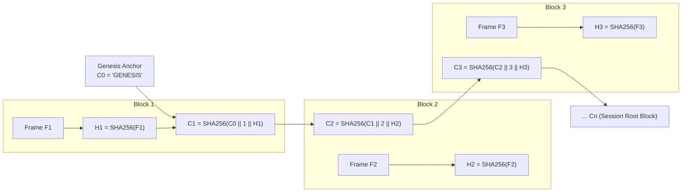

# 🛡️ Live Video Tamper Detection System Using SHA-256 Hash Chain

[](https://livevideotamperdetection.streamlit.app)
[](https://harshitmishra24aiml-cyber.github.io/livevideotamperdetection/)
[](https://harshitmishra24aiml-cyber.github.io/livevideotamperdetection/forensic_audit_certificate.html)
[](https://python.org)
[-red?style=flat-square)](https://csrc.nist.gov)
[](https://opensource.org/licenses/MIT)

> **A real-time Python-based video integrity monitoring and digital forensics system that detects unauthorized modifications to individual video frames and pinpoints where tampering has occurred using cryptographic hash chains.**

---

## 🌐 Live Working Links & Demonstrations

| Resource | Live Link | Description |
| :--- | :--- | :--- |
| **🚀 Web Dashboard** | [**Live Streamlit App**](https://livevideotamperdetection.streamlit.app) | Live capture studio, chain visualizer, tamper attack lab, and visual diff inspector. |
| **📊 Presentation Deck** | [**Interactive Slideshow (GitHub Pages)**](https://harshitmishra24aiml-cyber.github.io/livevideotamperdetection/presentation_slides.html) | Projector-ready 9-slide presentation with keyboard navigation. |
| **📄 Forensic Audit Certificate** | [**Digital Evidence Certificate**](https://harshitmishra24aiml-cyber.github.io/livevideotamperdetection/forensic_audit_certificate.html) | Print-ready forensic certificate with embedded pixel difference heatmaps and RSA signatures. |
| **🌐 GitHub Pages Portal** | [**Live Web Portal**](https://harshitmishra24aiml-cyber.github.io/livevideotamperdetection/) | Central hub connecting all web deliverables. |

---

## 📌 1. Project Overview

Digital video recordings captured by CCTV cameras, webcams, and surveillance streams are increasingly vulnerable to malicious tampering, including frame substitution, temporal reordering, frame deletion, and stealth pixel alterations.

This project implements a **real-time cryptographic video integrity monitoring system**. By generating a deterministic **SHA-256 hash** for every raw video frame and recursively linking these hashes in a **cryptographic hash chain** ($C_i = \text{SHA256}(C_{i-1} \mathbin{\Vert} i \mathbin{\Vert} H_i)$), any unauthorized modification to even a single pixel or frame index immediately breaks the chain and triggers tamper alerts.

### 🌟 Key Capabilities
- **Dual Cryptographic Hashing + Video Masking Detection**: Detects both bit-exact SHA-256 hash mismatches and spatial/temporal video masking attacks (digital redaction boxes, camera lens occlusion/blackout, and static clone inpainting).
- **Video Upload & Accuracy Inspector**: Dedicated browser and CLI workflow to upload any video file (`.mp4`, `.avi`, `.mov`) and automatically evaluate its **Integrity Accuracy (0% to 100%)** with visual mask bounding boxes and heatmaps.
- **Multi-Source Ingestion**: Supports Physical Webcams, Pre-recorded Video Files, and an **Animated Synthetic CCTV Surveillance Generator** (for automated headless demonstrations).
- **Lossless Frame Storage**: Stores video frames in PNG format to preserve bit-exact pixel buffers for deterministic verification.
- **Append-Only Cryptographic Audit Log**: Records frame metadata, timestamps, frame hashes, previous chain hashes, and current chain hashes in JSON Lines (`hash_log.jsonl`).
- **Comprehensive Forensic Auditor**: Detects modified pixels, missing/deleted frames, reordered frames, digital masks, and log corruption.
- **Pixel Difference Heatmap Inspector**: Computes side-by-side visual difference heatmaps showing the exact coordinates and bounding box of tampered pixels.
- **Tamper & Mask Attack Simulator**: 1-click cyber-attack simulator to inject digital redaction boxes, lens blackouts, watermark stamps, invisible single-pixel flips, frame drops, frame swaps, or log forgery.
- **Streamlit Cyber Forensics Dashboard**: Complete 6-tab interactive web interface with live HUD stream recording, video upload & accuracy inspector, blockchain visualizer, attack lab, and downloadable audit certificates.

---

## 📐 2. Cryptographic Algorithm & Mathematical Model

Let:
- $F_i$ = Video frame at sequence position $i$ ($i \ge 1$)
- $H_i$ = SHA-256 cryptographic digest of raw frame buffer bytes
- $C_i$ = Hash-chain value at frame position $i$
- $C_0$ = Genesis root anchor (`"GENESIS"`)

### Mathematical Equations:
1. **Frame Hash**:
   $$H_i = \text{SHA256}(\text{bytes}(F_i))$$
2. **Genesis Block**:
   $$C_0 = \text{"GENESIS"}$$
3. **Recursive Hash Chain Node**:
   $$C_i = \text{SHA256}(C_{i-1} \mathbin{\Vert} i \mathbin{\Vert} H_i)$$
   *Concatenation Scheme:* `f"{previous_hash}:{index}:{frame_hash}"`
4. **Session Root Signature (HMAC-SHA256)**:
   $$S = \text{HMAC-SHA256}_{K_{\text{secret}}}(\text{"SESSION\_ROOT"} \mathbin{\Vert} N \mathbin{\Vert} C_N)$$

### Chain Dependency Graph:



If an attacker modifies even a single pixel in $F_2$:
1. $H'_2 \ne H_2$ (Frame hash fails).
2. $C'_2 = \text{SHA256}(C_1 \mathbin{\Vert} 2 \mathbin{\Vert} H'_2) \ne C_2$ (Chain link breaks at Block 2).
3. Every subsequent block ($C_3, C_4, \dots, C_n$) fails verification due to the avalanche effect of SHA-256.

---

## 🏗️ 3. Architecture & Project Structure

```
hackathonaiml/
├── core/
│   ├── __init__.py            # Package exports
│   ├── hash_chain.py          # SHA-256 hashing, recursive chaining & HMAC signatures
│   ├── video_engine.py        # Webcam, file ingestion, synthetic CCTV & HUD overlay
│   ├── audit_logger.py        # Lossless PNG storage, JSONL logging & snapshot restore
│   └── verifier_engine.py     # Forensic verification & pixel difference heatmap
├── main.py                    # CLI video recording and chain generator
├── verifier.py                # CLI standalone forensic integrity verifier
├── tamper_simulator.py        # CLI attack simulator (modify, delete, swap, corrupt)
├── test_scenarios.py          # Automated unit test suite (5 attack scenarios)
├── app.py                     # Streamlit web monitoring dashboard
├── requirements.txt           # Project dependencies
├── README.md                  # System documentation
├── PROJECT_REPORT.md          # Comprehensive academic college report
└── evidence/                  # Evidence repository (lossless frames & audit log)
    ├── frames/                # Lossless frame PNG files (frame_000001.png, ...)
    ├── hash_log.jsonl         # Append-only cryptographic audit records
    └── session_manifest.json  # Cryptographic session certificate & signature
```

---

## ⚡ 4. Installation & Setup

### Prerequisites
- Python 3.9+ (Python 3.13 supported)
- Webcam (optional; system includes simulated CCTV feed)

### Install Dependencies
```bash
pip install -r requirements.txt
```

---

## 🚀 5. Quickstart & CLI Usage

### Step 1: Capture & Secure Video Stream
```bash
# Capture using synthetic animated CCTV feed (15 frames)
python main.py --synthetic --frames 15

# Capture using physical webcam (press 'Q' to stop)
python main.py --webcam 0

# Capture from a pre-recorded video file
python main.py --file path/to/video.mp4
```

### Step 2: Verify Video Integrity
```bash
python verifier.py
```
*Expected Output:*
```
==================================================
 CRYPTOGRAPHIC VIDEO INTEGRITY VERIFICATION
 Evidence Directory: evidence/frames
 Audit Log:          evidence/hash_log.jsonl
==================================================

[+] Frame 0001: AUTHENTIC  | Hash: 2086ac66fb...
[+] Frame 0002: AUTHENTIC  | Hash: 7249461481...
...
========== VERIFICATION REPORT ==========
Frames checked:         15
Authentic frames:       15
Integrity violations:   0
Session Root Signature: AUTHENTIC (Signature Verified)
------------------------------------------
RESULT: No tampering detected. All frames authentic.
==========================================
```

### Step 3: Simulate Tampering Attacks
Test how the verifier reacts to different cyber attacks:

```bash
# 1. Modify pixels in Frame 3 (inject unauthorized stamp)
python tamper_simulator.py --attack modify --frame 3

# 2. Run verification to see the tamper alert
python verifier.py

# 3. Test frame deletion (drop frame 4)
python tamper_simulator.py --attack delete --frame 4
python verifier.py

# 4. Test frame reordering (swap frames 5 and 6)
python tamper_simulator.py --attack swap --frame 5 --frame-b 6
python verifier.py

# 5. Restore clean baseline
python tamper_simulator.py --attack restore
```

### Step 4: Run Automated Verification Suite
Run unit tests across all 5 verification scenarios:
```bash
python test_scenarios.py
```

---

## 🖥️ 6. Streamlit Cyber Forensics Dashboard

Launch the browser-based dashboard:
```bash
streamlit run app.py
```

### Dashboard Features:
1. **Video Capture Studio**: Select stream source (Webcam, Synthetic CCTV, Video file), watch live HUD preview with frame hashes, and record evidence sessions.
2. **Hash Chain Explorer**: Blockchain-style interactive explorer showing Block 0 $\to$ Block 1 $\to$ Block 2 $\dots$ with thumbnails, mathematical formulas, and raw digests.
3. **Tamper Attack Lab**: 1-click attack buttons to alter frame pixels, drop frames, swap temporal sequence, or forge the log.
4. **Forensic Verifier & Heatmap**: Instant integrity verdict, KPI breakdown, and **Pixel Tamper Heatmap** showing side-by-side original vs tampered frame with JET difference colormap.
5. **Audit Certificate & Export**: Export forensic evidence reports in JSON, CSV, and Markdown format.

---

## 🔒 7. Security Analysis & Threat Model

| Threat / Attack Vector | Impact Without Hash Chain | Hash Chain Defense |
| :--- | :--- | :--- |
| **Pixel Modification** | Frame altered undetected | Frame SHA-256 ($H_i$) mismatches immediately. |
| **Frame Deletion** | Critical event deleted | Missing index / broken sequence gap flagged. |
| **Frame Reordering** | Sequence altered (alibi forgery) | Hash chain dependency ($C_i$) breaks at swapped node. |
| **Log Forgery** | Attacker edits log hash | Chain continuity breaks; HMAC root signature invalidates log. |
| **Post-Capture Re-synthesis** | Attacker re-chains tampered frames | Stopped by HMAC-SHA256 session root signature requiring private key. |

---

## 📚 8. Academic Evaluation & References
- MDPI Applied Sciences: *Reliable Integrity Preservation Analysis of Video Contents with Support of Blockchain Systems*, [DOI: 10.3390/app122010280](https://www.mdpi.com/2076-3417/12/20/10280).
- NIST FIPS 180-4: *Secure Hash Standard (SHS) - SHA-256 Specification*.
- ISO/IEC 27037: *Guidelines for Identification, Collection, Acquisition and Preservation of Digital Evidence*.
